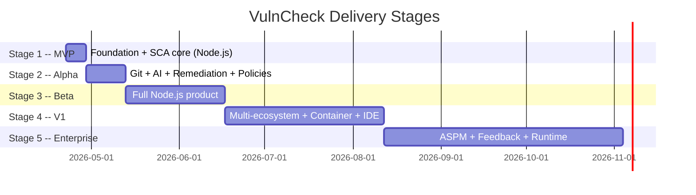

# VulnCheck Delivery Roadmap

The full master plan in [vulncheck_snyk-like_platform_41691b25.plan.md](vulncheck_snyk-like_platform_41691b25.plan.md) describes the finished product (28+ phases). This roadmap splits that into **5 staged deliveries**, each shippable and demoable on its own.

## Staging Principles

- **Every stage ends with a demoable artifact.** No stage leaves the product in a half-working state.
- **Later stages add without removing.** Stage N+1 extends Stage N; no rewrites.
- **Differentiators land early.** The killer feature (AI verdict + scope-aware severity) is available in Stage 2, so the product has a story from month 1.
- **Ecosystem width comes late.** Node.js is the only ecosystem until Stage 4. Nailing one ecosystem deeply is more valuable than superficial coverage of many.
- **Enterprise controls come after product-market fit.** Rego, VEX, SLSA, ASPM ship in Stages 4-5 because they matter for enterprise deals, not solo developers.

## Timeline

Cumulative effort (solo senior dev):
- End of Stage 1: ~1 week
- End of Stage 2: ~3 weeks
- End of Stage 3: ~8 weeks (~2 months)
- End of Stage 4: ~16 weeks (~4 months)
- End of Stage 5: ~28 weeks (~6-7 months)

With a team of 3: roughly divide by 2 (with coordination overhead). With a team of 6: divide by 3-4.

## What Each Stage Delivers (Elevator Pitch)

| Stage | Duration | Pitch |
| --- | --- | --- |
| **1 -- MVP** | 1 week | "Scan a Node.js lockfile, get 90% fewer false positives than npm audit thanks to dependency-scope awareness." |
| **2 -- Alpha** | 2 weeks | "Point us at your GitHub repo. We tell you which CVEs actually matter to YOUR code using AI. Safe fix suggestions. No alert dump." |
| **3 -- Beta** | 1 month | "Full Node.js AppSec: behavioral malware defense, call-graph reachability, license + SBOM + secrets + auto Fix PRs + Jira sync + monitoring. Customer-ready." |
| **4 -- V1** | 2 months | "All major ecosystems (Node.js + Python + .NET + Go), container scanning, enterprise policies (Rego + VEX + SLSA), full dashboard, VSCode + JetBrains plugins. GA-ready." |
| **5 -- V2** | 3+ months | "Enterprise ASPM: attack-story correlation, self-improving AI via feedback loop, optional eBPF runtime agent. Competitive with Apiiro / OX / Endor Labs." |

## Cross-Cutting Tracks (run in parallel to all stages)

Some work streams are not phase-specific and should run continuously once started:

- **Security self-audit (dogfooding)**: from Stage 1, enable `govulncheck` + `gosec` + `trivy fs` in CI on the platform's own codebase. Expand as new scanners come online.
- **Testing strategy**: unit tests per component from Stage 1; integration tests per phase; end-to-end smoke tests from Stage 2; load tests from Stage 4; fuzz tests for parsers from Stage 3.
- **Documentation**: README + API reference from Stage 1; user guides from Stage 3; enterprise deployment guide + compliance mapping from Stage 4.
- **Observability**: structured logs from Stage 1; Prometheus metrics from Stage 2; distributed tracing from Stage 3; SLO dashboards from Stage 4.
- **Rule maintenance**: SAST rules ship with positive + negative test cases from Stage 2 onwards; CI job runs `semgrep --test` on every PR; track per-rule FP rate from Stage 3.

## Risk-Based Ordering Rationale

Why this order and not another? Key decisions:

1. **AI in Stage 2, not Stage 1.** AI is the product differentiator but adding it to MVP blurs the core thesis ("scope awareness beats raw CVSS"). We want Stage 1 to prove the simpler thesis first.
2. **Behavioral analysis in Stage 3, not earlier.** It requires mature package tarball fetching + sandboxing infrastructure. Rushing it risks a security incident (sandboxed code escaping). Stage 3 gives us time to do it right.
3. **Call-graph before AI would be purist but wrong.** Call-graph is deterministic and cheaper but complex to build per-language. AI works day one with the LLM API. Ship AI first (Stage 2) for the demo, add call-graph later (Stage 3) as a cheaper replacement layer.
4. **Multi-ecosystem in Stage 4, not Stage 3.** Adding Python / .NET / Go too early dilutes the Node.js story. Nail Node.js first. Every additional ecosystem in Stage 4 gets to reuse mature core infrastructure.
5. **Container scanning in Stage 4 with the other ecosystem work.** It's a large scope increase, but lives in its own subsystem -- good fit with the ecosystem-expansion stage.
6. **ASPM last.** Correlation only works if you have good signals first. Stages 1-4 build the signals; Stage 5 joins them.

## How to Use These Plans

- Each stage plan has its own frontmatter with **todos** that track execution.
- File references use markdown links to the master plan sections. Example: [Phase E in master](vulncheck_snyk-like_platform_41691b25.plan.md) describes the Node.js SCA scanner in full; Stage 1 implements a minimal slice of it.
- When starting a stage, read that stage's plan file first, then jump to the referenced master-plan sections for depth.
- When a stage is done, the "Definition of Done" checklist must pass. Only then advance to the next stage.
- If a feature appears in multiple stages (e.g. AI runs Stage 2 -> 3 -> 4), each stage adds a specific slice defined in the stage plan.

## Quick Decision Tree

"I want to ship as fast as possible, what do I do?"
- Read [vulncheck_stage1_mvp.plan.md](vulncheck_stage1_mvp.plan.md). Execute. Ship in a week.

"I want the AI differentiator for a demo in 3 weeks."
- Stages 1 + 2. Execute both. Demo after ~3 weeks.

"I want customer-ready Node.js product."
- Stages 1 + 2 + 3. ~8 weeks.

"I want GA-ready multi-ecosystem product."
- Stages 1 + 2 + 3 + 4. ~16 weeks.

"I want enterprise ASPM competitor."
- All 5 stages. ~28 weeks.
